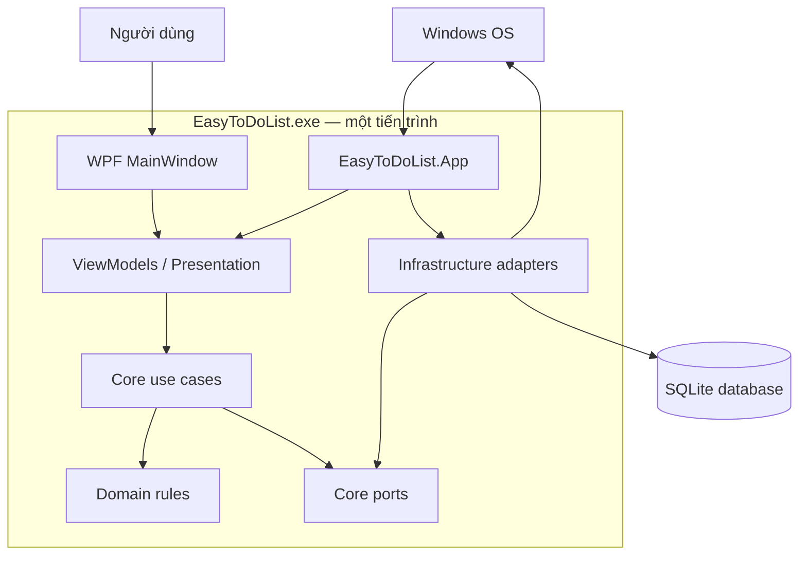
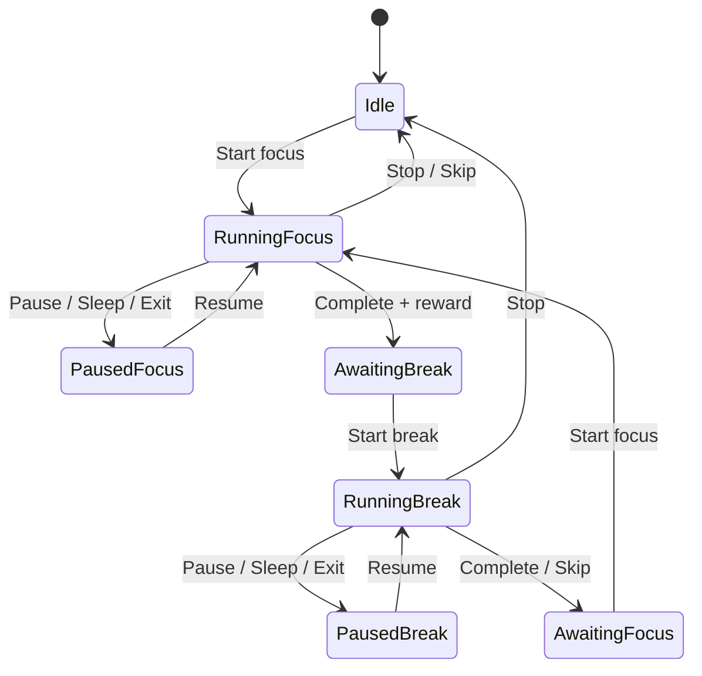
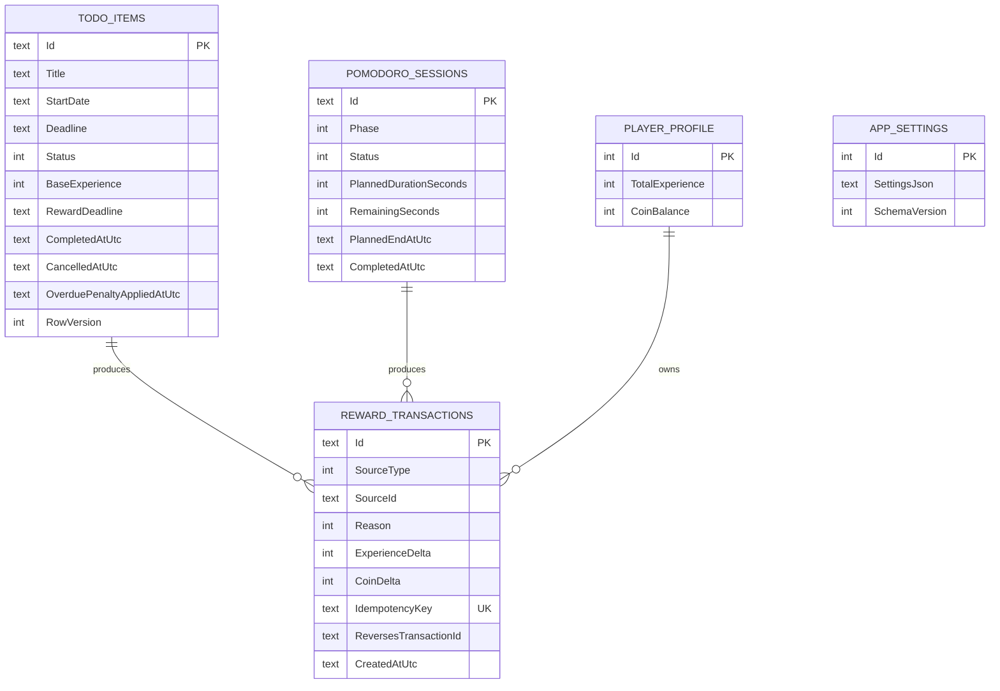
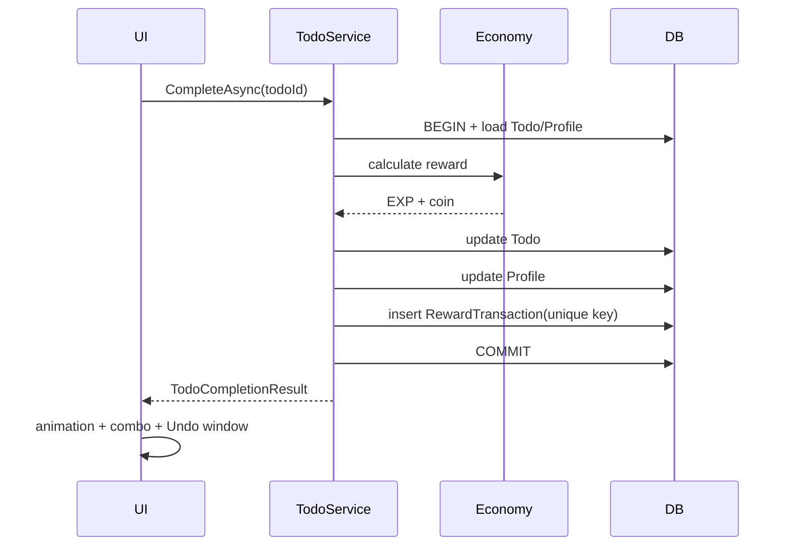

# EasyToDoList — System Design & Architecture

**Ngày:** 2026-11-11  
**Nguồn yêu cầu:** [`docs/superpowers/specs/2026-11-11-easy-to-do-list-design.md`](../superpowers/specs/2026-11-11-easy-to-do-list-design.md)

## 1. Architectural drivers

Kiến trúc phải ưu tiên:

1. Chạy offline, phản hồi nhanh và không phụ thuộc server.
2. Luật EXP, coin, deadline và Pomodoro đúng, kiểm thử được, không phụ thuộc WPF.
3. Mọi thay đổi To-do và phần thưởng phải nhất quán khi crash hoặc mở lại.
4. Chỉ một giao diện Dashboard/Overlay xuất hiện, nhưng timer và dữ liệu sống xuyên suốt khi đổi dạng.
5. Tích hợp Windows như tray, sleep/resume, startup và notification không rò vào domain.
6. Có đường nâng cấp lên API/PostgreSQL sau này nhưng không xây cloud abstraction trong MVP.

## 2. Kiểu kiến trúc được chọn

**Modular monolith trong một tiến trình WPF**, chia ba project sản phẩm:

- `EasyToDoList.App`: WPF, MVVM, navigation, animation, audio và điều phối cửa sổ.
- `EasyToDoList.Core`: entity, state machine, luật nghiệp vụ và use case.
- `EasyToDoList.Infrastructure`: SQLite và adapter Windows.

Các project target `.NET 10 LTS`; WPF project dùng TFM `net10.0-windows`, Core dùng `net10.0`. Bản phát hành self-contained nên máy người dùng không cần cài runtime riêng. Windows 11 x64 là nền tảng được hỗ trợ; Windows 10 22H2 chỉ được giữ tương thích best-effort vì đã hết vòng đời hỗ trợ chính thức.

Cơ sở chọn platform: [.NET 10 là LTS tới 2028-11-14](https://dotnet.microsoft.com/en-us/platform/support/policy) và [Windows 10 22H2 đã hết hỗ trợ ngày 2025-10-14](https://learn.microsoft.com/en-us/lifecycle/announcements/windows-10-22h2-end-of-support-update).

Không dùng microservice, event bus phân tán, CQRS, generic repository hay plugin framework. Ứng dụng chỉ có một người dùng cục bộ và một database; thêm những lớp này không giải quyết vấn đề hiện tại.



Quy tắc phụ thuộc:

```text
App ───────► Core
App ───────► Infrastructure
Infrastructure ───────► Core
Core ───────► không phụ thuộc project nào khác
```

## 3. Cấu trúc solution

```text
EasyToDoList.sln
├─ src/
│  ├─ EasyToDoList.App/
│  │  ├─ App.xaml(.cs)
│  │  ├─ Bootstrap/
│  │  ├─ Shell/
│  │  ├─ Features/
│  │  │  ├─ Today/
│  │  │  ├─ Calendar/
│  │  │  ├─ Pomodoro/
│  │  │  ├─ Profile/
│  │  │  └─ Settings/
│  │  ├─ Presentation/
│  │  │  ├─ Animation/
│  │  │  ├─ Audio/
│  │  │  └─ Combo/
│  │  └─ Resources/
│  ├─ EasyToDoList.Core/
│  │  ├─ Common/
│  │  ├─ Todos/
│  │  ├─ Economy/
│  │  ├─ Pomodoro/
│  │  ├─ Profile/
│  │  └─ Settings/
│  └─ EasyToDoList.Infrastructure/
│     ├─ Persistence/
│     └─ Windows/
└─ tests/
   ├─ EasyToDoList.Core.Tests/
   ├─ EasyToDoList.Infrastructure.Tests/
   └─ EasyToDoList.App.Tests/
```

Mỗi feature trong App đặt View và ViewModel cạnh nhau. Core chia theo nghiệp vụ thay vì chia thành thư mục `Entities/Services/Interfaces` toàn cục.

## 4. Shell và vòng đời ứng dụng

### 4.1. Một cửa sổ, ba trạng thái hiển thị

Ứng dụng dùng một `MainWindow`; không tạo hai cửa sổ Dashboard/Overlay để tránh hai nguồn state UI.

```csharp
public enum ShellDisplayMode
{
    Dashboard,
    Overlay,
    HiddenToTray
}

public enum OverlayMode
{
    Todo,
    Pomodoro
}
```

`ShellViewModel` giữ `DisplayMode` và `OverlayMode`. `WindowModeController` áp dụng kích thước, `Topmost`, chrome và vị trí tương ứng. Chuyển dạng chỉ đổi presentation; Core services và Pomodoro session không được tạo lại.

`X` gọi `HideToTray()`. Chỉ menu tray `Exit` mới chạy shutdown: pause Pomodoro đang chạy, flush database rồi đóng tiến trình.

### 4.2. Composition root

`App.xaml.cs` là composition root duy nhất:

- Đăng ký ViewModel và Core use case.
- Tạo `AppDbContext`/database factory.
- Đăng ký adapter Windows.
- Chạy migration và startup reconciliation trước khi hiện cửa sổ.
- Đăng ký/unregister sự kiện sleep/resume và tray.

Không dùng service locator trong ViewModel. Dependency được truyền qua constructor.

## 5. Core domain

### 5.1. To-do aggregate

`TodoItem` là aggregate root và sở hữu các invariant:

- Tiêu đề sau trim không được rỗng.
- `Deadline >= StartDate`.
- Chỉ Scheduled/Active/Overdue mới có thể Complete hoặc Cancel.
- Completed/Cancelled là trạng thái cuối, trừ use case Undo hợp lệ.
- Phạt quá hạn chỉ áp dụng một lần.
- Reward snapshot không tăng sau khi khóa.

Các trường chính:

```text
Id: Guid
Title: string
StartDate: DateOnly
Deadline: DateOnly
Status: TodoStatus
CreatedAtUtc / UpdatedAtUtc: DateTimeOffset
CompletedAtUtc / CancelledAtUtc: DateTimeOffset?
RewardStartDate / RewardDeadline: DateOnly?
RewardDurationDays / BaseExperience: int?
RewardLockedAtUtc: DateTimeOffset?
ForfeitedEarlyBonus: bool
OverduePenaltyAppliedAtUtc: DateTimeOffset?
RowVersion: long
```

`RowVersion` là optimistic concurrency token dù MVP một tiến trình; nó ngăn hai thao tác UI nhanh ghi đè nhau và giúp phát hiện stale state.

### 5.2. Economy

`EconomyCalculator` là pure domain service, nhận dữ liệu và trả kết quả, không truy cập database hay đồng hồ:

```csharp
int CalculateTodoBaseExperience(int durationDays);
int CalculateEarlyBonus(int baseExperience, int durationDays, int remainingDays);
int CalculateCancellationPenalty(int baseExperience);
int CalculateOverduePenalty(int baseExperience);
int CalculateLateRecovery(int baseExperience);
RewardAmount CalculateTodoCompletionReward(TodoRewardInput input);
RewardAmount CalculatePomodoroReward(int focusMinutes);
```

```csharp
public readonly record struct RewardAmount(int Experience, int Coins);
```

Mọi số cố định của economy nằm trong một `EconomyRules` nội bộ có test đặc tả; không tạo màn hình chỉnh economy trong MVP.

Mọi phép `round` của economy dùng `MidpointRounding.AwayFromZero` để kết quả số `.5` ổn định và dễ giải thích cho người dùng.

`PlayerProfile` lưu `TotalExperience` và `CoinBalance`. Level/rank được suy ra từ tổng EXP để không lưu state trùng lặp.

### 5.3. Reward ledger

Một bảng/giao dịch thưởng có thể chứa cả EXP và coin:

```text
RewardTransaction
Id: Guid
SourceType: Todo | Pomodoro | System
SourceId: Guid
Reason: Completion | EarlyBonus | OverduePenalty | LateRecovery | Cancellation | Undo
ExperienceDelta: int
CoinDelta: int
IdempotencyKey: string UNIQUE
ReversesTransactionId: Guid?
CreatedAtUtc: DateTimeOffset
```

`PlayerProfile` và `RewardTransaction` luôn cập nhật trong cùng SQLite transaction. `IdempotencyKey` chặn thưởng/phạt trùng khi retry sau crash.

Undo không xóa transaction; nó tạo transaction đảo với `ReversesTransactionId` và key riêng.

### 5.4. Pomodoro state machine



`PomodoroSession` lưu preset đã chụp tại lúc bắt đầu; chỉnh Settings không thay đổi phiên hiện tại.

Các trường chính:

```text
Id: Guid
Phase: Focus | ShortBreak | LongBreak
Status: Running | Paused | Completed | Stopped | Skipped
PlannedDurationSeconds: int
RemainingSeconds: int
StartedAtUtc / PlannedEndAtUtc / PausedAtUtc / CompletedAtUtc: DateTimeOffset?
CompletedFocusCount: int
RewardAppliedAtUtc: DateTimeOffset?
```

`PomodoroService` là session service duy nhất. UI timer chỉ yêu cầu snapshot để render, không tự giảm và lưu bộ đếm.

Khi Running, thời gian còn lại được tính từ `PlannedEndAtUtc - clock.UtcNow`. Một dispatcher timer chỉ refresh UI; nó không phải nguồn thời gian. Khi Pause/sleep/Exit, service tính và persist `RemainingSeconds`, xóa `PlannedEndAtUtc`. Khi Resume, tạo `PlannedEndAtUtc` mới.

## 6. Application use cases

Core cung cấp các use case cụ thể thay vì generic CRUD:

```csharp
public interface ITodoService
{
    Task<TodoItem> CreateAsync(CreateTodoCommand command, CancellationToken ct);
    Task<TodoItem> UpdateScheduleAsync(UpdateTodoScheduleCommand command, CancellationToken ct);
    Task<TodoCompletionResult> CompleteAsync(Guid todoId, CancellationToken ct);
    Task UndoCompletionAsync(Guid todoId, Guid completionTransactionId, CancellationToken ct);
    Task CancelAsync(Guid todoId, CancellationToken ct);
    Task<IReadOnlyList<TodoItem>> GetTodayAsync(DateOnly localDate, CancellationToken ct);
}

public interface IPomodoroService
{
    PomodoroSnapshot Current { get; }
    Task StartAsync(PomodoroConfiguration configuration, CancellationToken ct);
    Task PauseAsync(PauseReason reason, CancellationToken ct);
    Task ResumeAsync(CancellationToken ct);
    Task SkipAsync(CancellationToken ct);
    Task StopAsync(CancellationToken ct);
    Task TickAsync(CancellationToken ct);
}

public interface IDailyReconciliationService
{
    Task ReconcileAsync(DateOnly localDate, CancellationToken ct);
}
```

Các use case thay đổi nhiều bảng dùng một transaction boundary nhỏ, không phải generic repository:

```csharp
public interface IAppUnitOfWork
{
    ITodoStore Todos { get; }
    IRewardStore Rewards { get; }
    IProfileStore Profile { get; }
    Task<T> ExecuteAsync<T>(Func<CancellationToken, Task<T>> action, CancellationToken ct);
}
```

Các command/result là immutable record. UI không nhận `DbContext`, repository hoặc EF entity trực tiếp.

## 7. Persistence design

### 7.1. SQLite tables



`AppSettings` dùng một JSON document có version vì Settings là dữ liệu cục bộ nhỏ và thay đổi cùng nhau. Entity nghiệp vụ và ledger dùng cột chuẩn để có constraint, index và query rõ ràng.

Index tối thiểu:

- `TodoItems(Status, StartDate, Deadline)` cho Today/reconciliation.
- `TodoItems(CompletedAtUtc)` cho lịch sử.
- Unique `RewardTransactions(IdempotencyKey)`.
- `RewardTransactions(CreatedAtUtc)` cho lịch sử giao dịch.
- `PomodoroSessions(Status)` để tìm phiên chưa kết thúc.

Database đặt trong thư mục dữ liệu người dùng của Windows, không đặt cạnh executable. Migration chạy trước startup reconciliation. Mỗi migration phải có integration test tạo database mới và nâng cấp database phiên bản trước khi có migration thay đổi schema.

### 7.2. Transaction boundaries

Hoàn thành To-do là một SQLite transaction:



Nếu bất kỳ bước database nào lỗi, không có trạng thái hoặc phần thưởng nào được lưu. Animation chỉ chạy sau commit thành công.

Pomodoro completion, cancellation, overdue penalty và Undo dùng cùng nguyên tắc transaction.

## 8. Scheduling và clock

`IClock` cung cấp `UtcNow` và `LocalToday`, cho phép test qua ngày mà không đổi đồng hồ máy.

`DailyReconciliationService` chạy:

- Sau migration khi mở ứng dụng.
- Khi ứng dụng đang chạy và tới local midnight.
- Sau resume từ sleep.
- Sau khi Windows báo đổi giờ/múi giờ, nếu API khả dụng.

Service khóa reward snapshot cho To-do vừa bắt đầu và áp dụng phạt cho To-do vừa quá hạn. Mỗi tác vụ có idempotency key riêng, nên gọi lặp an toàn.

MVP chấp nhận người dùng chỉnh đồng hồ máy; mục tiêu là nhất quán nội bộ chứ không chống gian lận.

## 9. Presentation architecture

ViewModel gọi use case và chuyển result thành UI state. Không chứa công thức economy, truy vấn EF hoặc phép tính thời gian Pomodoro.

Các state presentation đáng chú ý:

- `TodoItemViewModel`: pending/completing/completed để giữ chỗ trong lúc animation 700–900 ms.
- `ComboTracker`: nhận completion event sau commit; reset cửa sổ 2 giây; không persist.
- `ComboViewModel`: hiển thị hệ số và progress vòng tròn từ 2 giây về 0; completion mới reset progress.
- `UndoCoordinator`: giữ completion token trong 5 giây; gọi Core để đảo giao dịch.
- `RewardToastViewModel`: hiển thị EXP/coin từ result, không tự tính lại.
- `PomodoroViewModel`: render snapshot từ service.

Animation và audio là hiệu ứng sau commit. Khi animation/audio bị tắt hoặc lỗi, nghiệp vụ vẫn hoàn tất. Reduced Motion thay animation vỡ bằng fade/đổi trạng thái ngắn và giữ thông tin chữ.

## 10. Windows adapters

Infrastructure triển khai các port:

```csharp
public interface ISystemNotificationService;
public interface ISystemTrayService;
public interface IPowerStateService;
public interface IStartupRegistrationService;
public interface IAudioPlaybackService;
public interface IUserDataPathProvider;
```

Adapter Windows không được gọi từ domain entity. App đăng ký callback và chuyển thành lệnh Core, ví dụ sự kiện suspend gọi `PomodoroService.PauseAsync(PauseReason.SystemSleep)`.

Thông báo chỉ được lập lịch trong tiến trình. Khi `Exit`, không có background agent. Khi nằm trong tray, tiến trình vẫn chạy và notification/timer tiếp tục.

## 11. Error handling và recovery

- Validation nghiệp vụ trả lỗi có cấu trúc để UI hiển thị cạnh field.
- Lỗi database không được nuốt; UI báo thao tác chưa được lưu và không phát animation thưởng.
- Startup migration lỗi: không mở Dashboard với database nửa nâng cấp; hiển thị màn hình lỗi cùng đường dẫn backup/log.
- Chỉ cho phép một instance ứng dụng ghi database. Instance thứ hai chuyển focus sang instance đang chạy rồi thoát.
- Log cục bộ có rolling file và không ghi nội dung To-do nếu không cần thiết.
- Khi Settings JSON lỗi, dùng default an toàn và giữ bản lỗi để chẩn đoán; không xóa database.
- Khi phát hiện Pomodoro Running sau crash, chuyển sang Paused bằng remaining time đã persist gần nhất; không trao thưởng tự động.

## 12. Testing architecture

### Core unit tests

- Toàn bộ công thức EXP/coin, boundary 1/14 ngày, early/late/cancel.
- Level/rank tại đúng mốc và khi EXP giảm.
- Pomodoro validation và state transitions.
- Todo invariant và reward lock.
- Clock boundary ở midnight.

### Infrastructure integration tests

- SQLite migration và constraint/index.
- Transaction atomicity và unique idempotency key.
- Startup reconciliation chạy lặp không trừ/thưởng hai lần.
- Khôi phục Pomodoro sau crash/sleep giả lập.

### App tests

- ViewModel chuyển Dashboard/Overlay/Tray nhưng giữ cùng Pomodoro service.
- Complete chỉ phát animation sau khi use case thành công.
- Combo 2 giây và Undo 5 giây dùng fake clock.
- Reduced Motion và tắt âm thanh không cản hoàn thành việc.

Không đặt mục tiêu UI automation end-to-end cho mọi màn hình trong MVP. Dùng một smoke test thủ công cho installer, tray, notification, sleep/resume và DPI scaling vì các hành vi này phụ thuộc Windows thật.

## 13. Non-functional targets

- Startup tới cửa sổ tương tác được: mục tiêu dưới 2 giây trên máy phát triển thông thường.
- Thao tác thêm/tick To-do: UI phản hồi ngay; database commit không chạy trên UI thread.
- Timer hiển thị sai tối đa 1 giây khi ứng dụng hoạt động.
- Không mất hoặc nhân đôi EXP/coin sau retry/crash.
- Chạy offline hoàn toàn.
- Keyboard navigation và trạng thái focus dùng được ở Dashboard; thông tin không chỉ truyền đạt bằng màu, âm thanh hoặc animation.

## 14. Đường nâng cấp tương lai

Khi cần cloud sync:

1. Giữ Core rules và ViewModel contracts.
2. Thêm ASP.NET Core API sở hữu PostgreSQL.
3. Thay local application gateway bằng sync-aware gateway; SQLite trở thành cache/offline store.
4. Thêm `UserId`, server revision và conflict policy trong một migration riêng.

Không thêm các trường hoặc interface cloud vào MVP trước khi có yêu cầu sync cụ thể.

Khi xây cửa hàng:

1. Thêm catalog cosmetic versioned.
2. Thêm inventory và purchase transaction nguyên tử.
3. Trừ coin cùng lúc tạo ownership record.
4. Asset được tải từ bundle cục bộ hoặc dịch vụ riêng tùy phạm vi lúc đó.

## 15. Architecture decisions

| ID | Quyết định | Lý do |
|---|---|---|
| ADR-001 | Modular monolith, 3 project sản phẩm | Tách đúng ranh giới mà không phân tán hệ thống |
| ADR-002 | Một MainWindow đổi mode | Tránh hai UI state và bảo đảm chỉ một dạng xuất hiện |
| ADR-003 | SQLite là source of truth cục bộ | Offline, triển khai đơn giản |
| ADR-004 | Profile + immutable reward ledger | Đọc nhanh nhưng vẫn audit/Undo được |
| ADR-005 | Database transaction cho state + reward | Không lệch To-do/Pomodoro với EXP/coin |
| ADR-006 | Deadline-based Pomodoro timer | Không tích lũy sai số do decrement mỗi tick |
| ADR-007 | OS integration qua adapter | Core kiểm thử được và không phụ thuộc Windows |
| ADR-008 | Presentation effects chạy sau commit | Animation/audio lỗi không làm sai dữ liệu |
| ADR-009 | Không generic repository/CQRS | Không có nhiều persistence backend hoặc scale cần chúng |
| ADR-010 | Cloud/shop là thiết kế riêng tương lai | Tránh xây khả năng chưa dùng |

